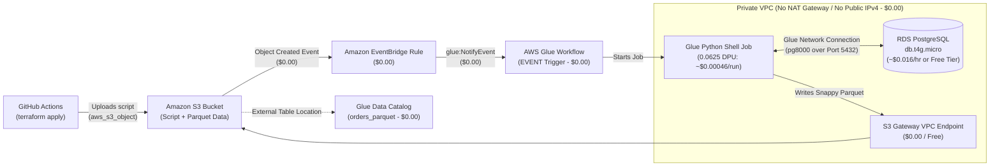

# AWS Glue + Private RDS PostgreSQL + S3 Parquet + Data Catalog + Auto-Triggered Glue Workflow PoC

## Architecture & Cost Breakdown



| Resource | Configuration | Cost |
| :--- | :--- | :--- |
| **VPC, Subnets, Security Group** | 2 Private Subnets, self-referencing SG rule for Glue | **$0.00** |
| **S3 Gateway VPC Endpoint** | Routes S3 traffic privately without a $32/mo NAT Gateway | **$0.00** |
| **Public IPv4 Address** | Disabled (`publicly_accessible = false`) | **$0.00** (saves $0.005/hr) |
| **RDS PostgreSQL** | `db.t4g.micro`, Single-AZ, 20 GB gp2, no backups | **~$0.016/hr** ($0.00 on Free Tier) |
| **AWS Glue Job** | Python Shell (`pythonshell`), `0.0625 DPU` (1/16 DPU) | **~$0.00046 per 1-min run** |
| **Glue Workflow + `EVENT` Trigger** | Triggered automatically via EventBridge when script is deployed | **$0.00** |
| **EventBridge + S3 Notifications** | Default bus AWS service events (`aws.s3` `Object Created`) | **$0.00** |
| **Glue Data Catalog** | 1 Database + 1 Parquet Table (`orders_parquet`) | **$0.00** (Free under 1M objects) |

---

## Project Structure

- [versions.tf](file:///C:/Users/mrj84/glue-rds-poc/terraform/versions.tf) — Terraform & S3 state backend configuration
- [variables.tf](file:///C:/Users/mrj84/glue-rds-poc/terraform/variables.tf) — Input variables (`aws_region`, `project_name`, `force_workflow_trigger_token`)
- [network.tf](file:///C:/Users/mrj84/glue-rds-poc/terraform/network.tf) — Private VPC, 2 private subnets, Glue self-referencing Security Group, and free S3 Gateway VPC Endpoint
- [rds.tf](file:///C:/Users/mrj84/glue-rds-poc/terraform/rds.tf) — Private Single-AZ `db.t4g.micro` PostgreSQL instance
- [glue.tf](file:///C:/Users/mrj84/glue-rds-poc/terraform/glue.tf) — S3 bucket, Glue Catalog Database & Parquet Table, Glue Network Connection, Glue Python Shell Job, Glue Workflow (`EVENT` trigger), and EventBridge rule
- [outputs.tf](file:///C:/Users/mrj84/glue-rds-poc/terraform/outputs.tf) — Useful resource names and URIs for verification
- [glue_rds_to_parquet.py](file:///C:/Users/mrj84/glue-rds-poc/scripts/glue_rds_to_parquet.py) — Seeds RDS `orders` table via `pg8000`, transforms data with `pandas`, and writes Snappy Parquet to S3 via `pyarrow`
- [deploy-glue-poc.yml](file:///C:/Users/mrj84/glue-rds-poc/.github/workflows/deploy-glue-poc.yml) — GitHub Actions pipeline with automatic deploy + trigger verification and one-click `destroy`

---

## Step-by-Step Setup & Verification Guide

### 1. Configure GitHub Secrets
In your GitHub repository, navigate to **Settings -> Secrets and variables -> Actions** and add:
- `AWS_ACCESS_KEY_ID` — IAM user access key with permissions for VPC, RDS, S3, IAM, Glue, and EventBridge
- `AWS_SECRET_ACCESS_KEY` — IAM user secret key
- `TF_STATE_BUCKET` — A globally unique S3 bucket name for Terraform state (e.g., `my-glue-rds-poc-tfstate-2026`). The GitHub Actions workflow will automatically create this bucket if it doesn't exist yet.

### 2. Deploy via GitHub Actions (or Locally)
- **Via GitHub Actions**: Push this repository to the `main` branch (or go to **Actions -> Deploy & Trigger Glue Workflow -> Run workflow -> `apply`**).
- **How the Auto-Trigger Works**:
  1. Terraform creates the VPC, RDS instance, Glue Catalog, Glue Job, Glue Workflow (`EVENT` trigger), and EventBridge rule.
  2. Last (enforced via `depends_on`), Terraform uploads `scripts/glue_rds_to_parquet.py` to S3 with metadata containing the current Git commit SHA (`force_workflow_trigger_token`).
  3. S3 emits an `Object Created` event to EventBridge -> EventBridge calls `glue:NotifyEvent` on the Glue Workflow -> the Glue Workflow `EVENT` trigger automatically starts the Glue Python Shell job!

### 3. Inspect in the AWS Console
1. **Verify the Automatic Workflow Run**:
   - Open **AWS Console -> AWS Glue -> Workflows** (under *Data Integration and ETL*).
   - Click **`glue-rds-poc-workflow`**.
   - In the **History** tab at the bottom, you will see a workflow run already in `RUNNING` or `COMPLETED` status—started automatically by the `glue-rds-poc-event-trigger` without any manual click!
   - Click the run and select **View run details** to see the visual graph (`glue-rds-poc-event-trigger` -> `glue-rds-poc-rds-to-parquet`).
2. **Verify the Parquet File in S3**:
   - Open **Amazon S3 -> Buckets -> `glue-rds-poc-<suffix>` -> `data/orders/`**.
   - Confirm `orders.parquet` was created.
3. **Verify the Glue Data Catalog Table & Query with Athena**:
   - Open **AWS Glue -> Data Catalog -> Databases -> `glue_rds_poc_catalog_db` -> Tables -> `orders_parquet`**.
   - Click **Table data (View data)** to open **Amazon Athena** and run:
     ```sql
     SELECT * FROM "glue_rds_poc_catalog_db"."orders_parquet" ORDER BY order_id;
     ```
   - *(Note: Athena charges $5.00 per TB scanned; scanning this 2 KB Parquet file costs virtually $0.00).*

> [!IMPORTANT]
> **Remember to Destroy When Done Testing!**
> While Glue, S3, EventBridge, and the VPC cost **$0.00** while idle, the `db.t4g.micro` RDS PostgreSQL instance costs **~$0.016/hr** (~$0.38/day) if your AWS account is outside the 12-month Free Tier.
> To delete everything with 1 click: go to **GitHub Actions -> Deploy & Trigger Glue Workflow -> Run workflow -> Select `destroy`**.
